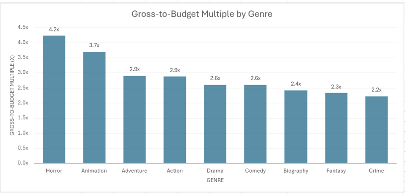
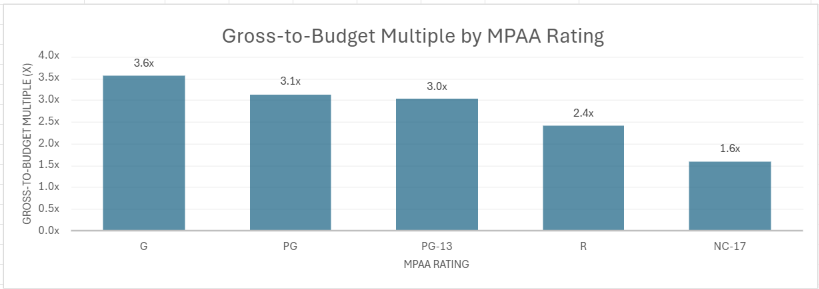
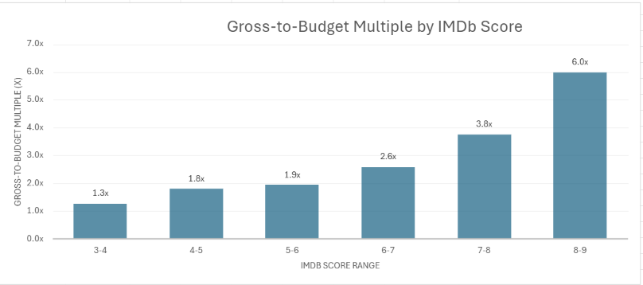

# Movie Industry Gross-to-Budget Analysis

*Guided project, CourseCareers Data Analytics course*

## Overview
This project analyzes 7,668 films spanning 1980-2020 to identify which movie characteristics generate the highest gross-to-budget multiple (box-office gross ÷ production budget). By examining genre, rating, and critical reception, this analysis reveals patterns about film box-office performance. The key finding: Horror films achieve a 4.22x gross-to-budget multiple on a median budget of $9.35M, the highest of any genre with at least 30 films and well above the industry figure of 2.87x.

## Business Question
Film studios invest millions in production budgets without reliable frameworks for predicting returns, which results in unpredictable box-office outcomes and significant financial losses. Due to the lack of reliable frameworks, the film industry lacks guidance on which film characteristics (genre, rating category, and score) generate the most box-office gross per budget dollar. Which movies achieve the highest gross-to-budget multiple? What factors are linked to stronger box-office returns?

## Methodology
- Adjusted gross revenue totals to 2023 dollars using CPI data to ensure fair comparison across decades (multiples use same-year budget and gross, so they don't need adjusting)
- Calculated the gross-to-budget multiple as: total gross ÷ total budget for each group
- Excluded 2,232 movies with missing budget or revenue data (data quality validation), leaving 5,436 films
- Analyzed patterns by genre, MPAA rating, IMDb score, and release year
- Left groups with fewer than 30 films out of the charts, because one film can decide the result in a group that small

## Key Findings
1. Horror Films Deliver the Highest Multiple of Any Major Genre (4.22x on a $9.35M median budget, vs. 2.87x for action on a $40M median budget)
2. Critical Score Is Strongly Linked to Box-Office Returns (films scored 7+ achieve 4.11x vs. 1.65x for films scored under 5)
3. G-Rated Films Outperform R-Rated by 48% (3.55x vs. 2.40x)
4. Inflation Adjustment Changes the Scale (the dataset's total gross of $587B equals about $932B in 2023 dollars)

## Skills Demonstrated
- **Excel:** Pivot tables with a calculated field, SUMIFS, MEDIAN(IF()), XLOOKUP, IF/ISNUMBER, charts, data quality checks
- **Financial Analysis:** Gross-to-budget multiples, inflation adjustment using CPI
- **Data Cleaning:** Identified and excluded incomplete records

## Tools Used
- Microsoft Excel
- CPI data for inflation adjustment

## Results & Recommendations
Films in the Horror genre achieve a 4.22x gross-to-budget multiple compared to the 2.87x industry figure, the highest of any genre with at least 30 films. Horror reaches this on a $9.35M median production budget, compared with $40M for action and $16M for drama. Films rated 8.0+ achieve a 5.96x multiple versus poorly-rated films (under 4.0) at 1.19x. Film quality appears to be strongly linked to box-office returns. G-rated films achieve a 3.55x multiple compared to R-rated at 2.40x, though G is a much smaller group (111 films vs. 2,597).

Family films show the highest raw multiple (10.14x), but the genre has only 4 films and E.T. accounts for 61% of their gross, so Family is left out of the genre comparison.

These patterns suggest that lower-budget, well-reviewed films, especially in horror, have historically returned the most box-office gross per budget dollar. Box-office gross is not profit (theaters keep a share and marketing costs aren't included), and these results show correlation, not causation. They are a starting point for further analysis rather than a production strategy.

## Next Steps
1. Add marketing costs and the studio's share of box office to estimate profit instead of gross
2. Add more complete data for 2020, which has only 25 films in the dataset

---

## Project Files & Visualizations

### 📊 Excel Workbook
**[Download Complete Analysis: Movie_Budget_vs_Box_Office.xlsx](Movie_Budget_vs_Box_Office.xlsx)**

See the Key figures section on the Dashboard tab for every number in this README.

### 📈 Key Charts

#### Gross-to-Budget Multiple by Genre

#### Gross-to-Budget Multiple by MPAA Rating

#### Gross-to-Budget Multiple by IMDb Score

